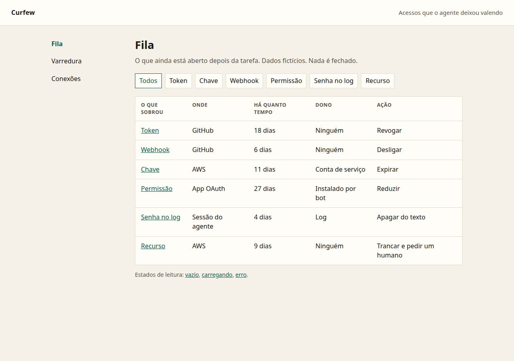
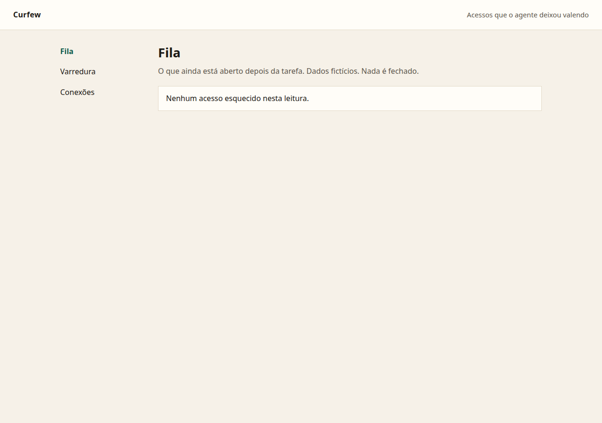
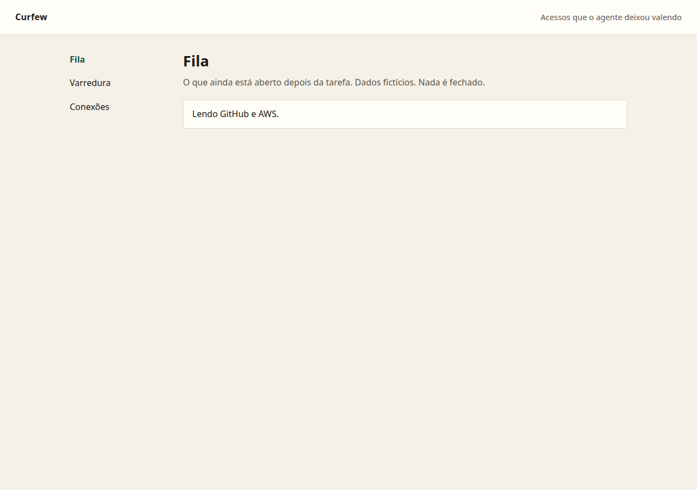
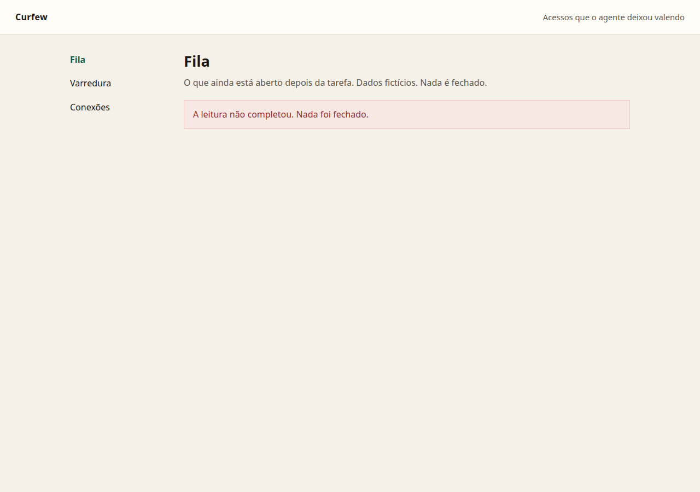
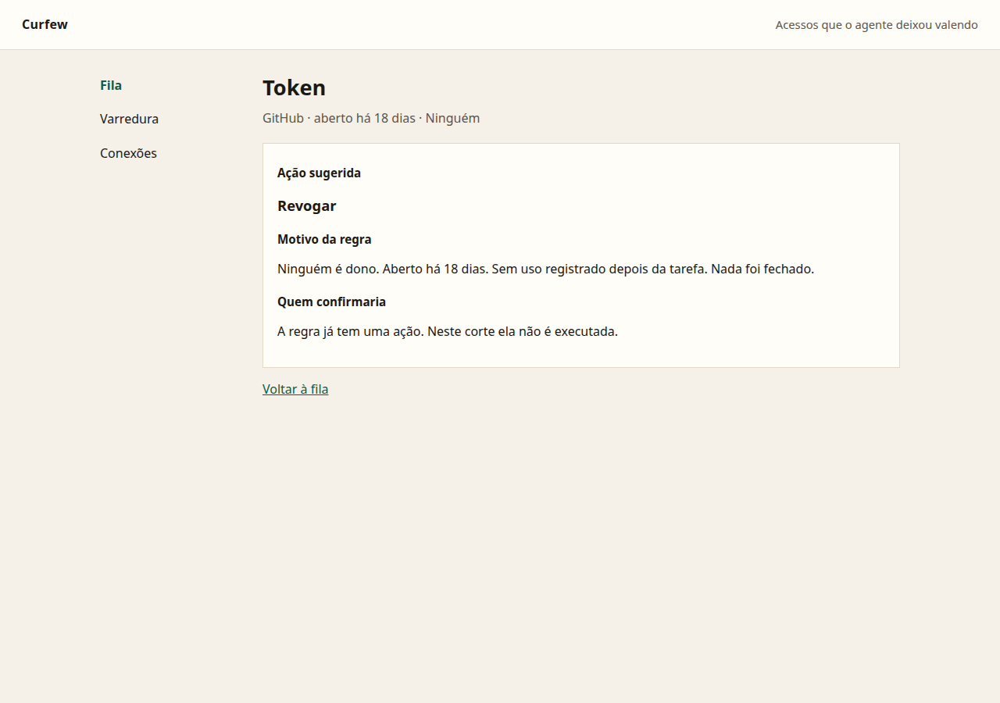
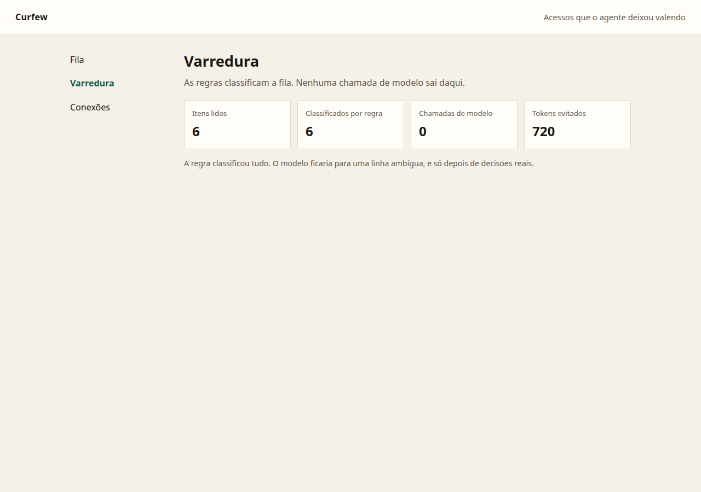
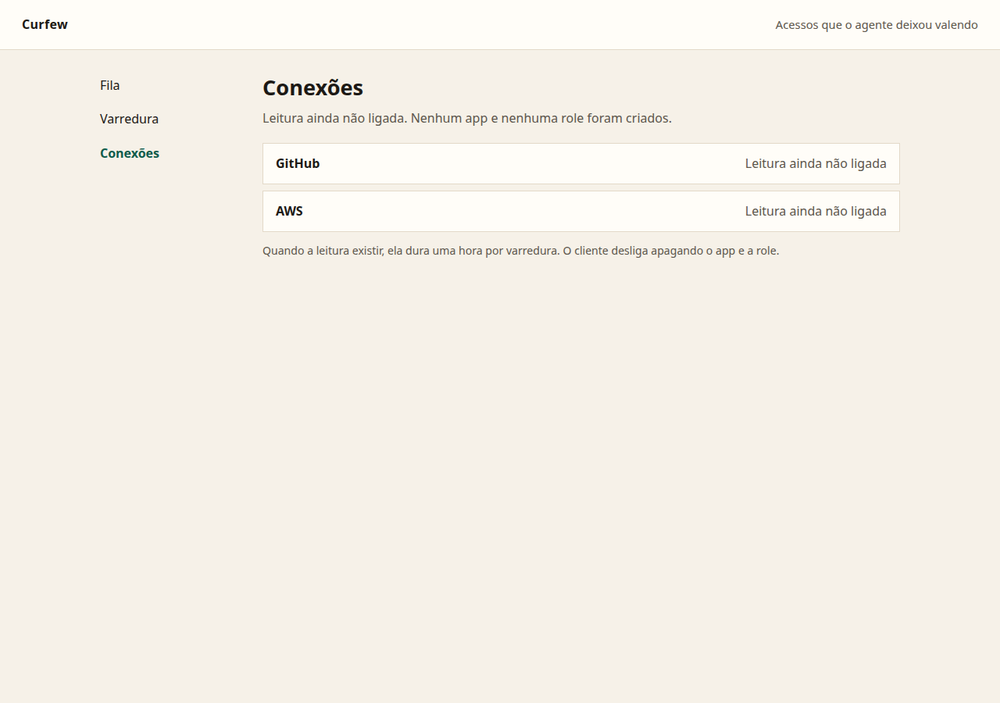
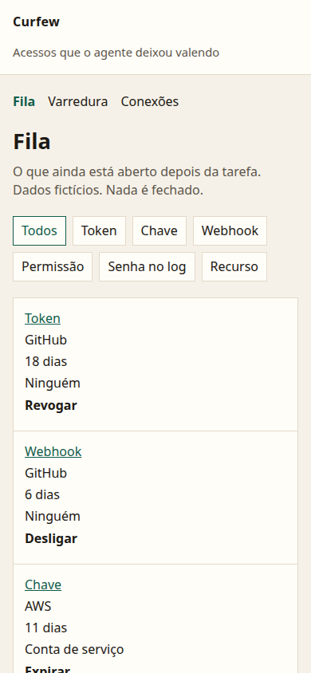
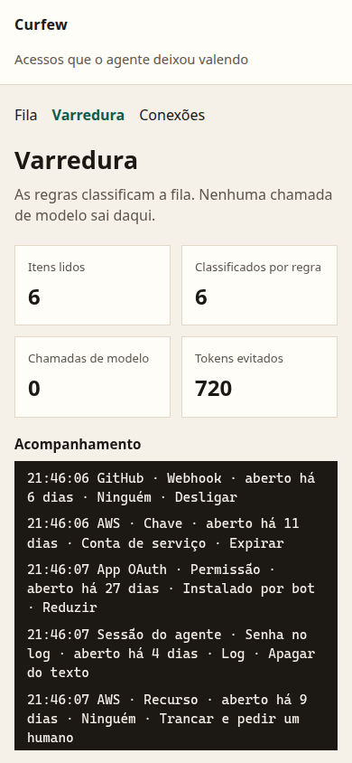

# Curfew

Fila dos acessos que um agente de IA deixou valendo: token, chave, webhook, permissão larga e senha no log. Este corte mostra dados fictícios. Nada é lido de uma conta real e nada é fechado.

O plano de produto está em [docs/plano.md](docs/plano.md). A página do produto está em [docs/index.html](docs/index.html).

## Telas

Fila.



Fila vazia, carregando e com erro.





Detalhe de um acesso.



Varredura, com o log ao vivo.



Conexões ainda sem leitura.



A fila e a varredura no celular.




## Página no GitHub Pages

A landing fica em `docs/`. No GitHub, em Settings, Pages, a origem é GitHub Actions. O workflow `.github/workflows/pages.yml` publica a pasta `docs` a cada push na `main` que mude essa pasta.

## Instalação

É preciso Java 21. O Maven vem no wrapper.

```bash
java -version
./mvnw -version
```

## Build e execução

```bash
./mvnw test
./mvnw package
./mvnw quarkus:dev
```

O dev sobe em [http://127.0.0.1:8473/](http://127.0.0.1:8473/).

Telas: `/` fila, `/acessos/gh-token-18` detalhe, `/varredura` log ao vivo, `/conexoes`. Os estados de exemplo são `/?estado=vazio`, `/?estado=carregando` e `/?estado=erro`.

Sem variável, a fila é o exemplo. Para ler a conta de verdade, exporte `CURFEW_GITHUB_TOKEN` (leitura de repositório) ou o par `CURFEW_AWS_ACCESS_KEY_ID` e `CURFEW_AWS_SECRET_ACCESS_KEY` (IAM `ListAccessKeys`). A fila guarda nome, idade e dono. URL, material de chave e valor de segredo são descartados. Nada é fechado. Os testes ignoram essas variáveis.

Para provar as telas no ar, na raiz:

```bash
python3 .cursor/skills/verify-curfew/verify-curfew.py prove
```

O comando sobe uma instância sem as variáveis de conta, confere a varredura do exemplo e grava o print em `.cursor/skills/verify-curfew/artifacts/`. Ele encerra o processo que ele mesmo subiu. Rode isso antes de `./mvnw test` se a porta 8473 ainda estiver ocupada.

Um plano de várias mudanças só segue depois que `python3 .cursor/skills/verify-curfew/verify-curfew.py plan <arquivo>` aceita o arquivo. Cada item precisa de prova no ar. Deploy e fechamento de acesso são recusados. Apague o plano quando o corte fechar. Rascunho de tela fica em `scratch/` e não entra no código.

A passagem da noite aparece em `/varredura`. O botão tira da fila o que não pede humano. A conta não é chamada. Para apagar webhook, chave de deploy e nome de segredo no GitHub, exporte `CURFEW_CLOSE=sim` junto com `CURFEW_GITHUB_TOKEN`. Produção continua de fora. O identificador completo de chave AWS não é guardado, então essa chave não é apagada por aqui.

A chave com prazo aparece na fila. A tarefa pede GitHub ou AWS e recebe no máximo 23 horas. O formulário mostra a validade e não emite o segredo. 24 horas ou mais é recusado. Para pedir a sessão AWS de verdade, envie `POST /chaves` com `Accept: application/json` e exporte `CURFEW_ISSUE=sim` junto com o par `CURFEW_AWS_ACCESS_KEY_ID` e `CURFEW_AWS_SECRET_ACCESS_KEY`. A resposta traz o segredo uma vez. A página seguinte mostra só os quatro finais.

`./mvnw package` gera `target/function.zip`. Gerar o zip não publica nada. Não rode `sam deploy` neste corte.

## Erros comuns

| Sintoma | O que fazer |
| --- | --- |
| `release version 21 not supported` | Instale o JDK 21 e confira `JAVA_HOME`. |
| `Address already in use` | A porta 8473 está presa. Encerre o outro processo ou mude `quarkus.http.port`. |
| `./mvnw` sem permissão | Rode `chmod +x mvnw`. |
| Wrapper falha na primeira vez | O `mvnw` baixa o Maven. Sem rede, essa etapa falha. |
| Página em branco | Confira se o dev ainda está de pé na porta 8473. |

## Desenvolvimento

A fila fictícia está em `src/main/java/curfew/scan/MockAccessSource.java`. As regras estão em `ScanRules`. `TokenLedger` conta tokens que um modelo teria gasto. Neste corte as chamadas de modelo são zero.

O log ao vivo sai de `GET /varredura/eventos`. Cada linha leva sistema, idade, dono e ação. Sem segredo.

Em dev e teste a fila fica na memória. O perfil de produção usa DynamoDB, tabela `curfew-access`, em `template.yaml`. Não há campo para o valor de um segredo.

Para um agente, `.cursor/skills/curfew/SKILL.md` e `AGENTS.md` repetem o limite deste corte: sem conector, sem credencial de cliente, sem deploy e sem `CURFEW_CLOSE` até um sim explícito. Os playbooks da poteto-mode estão no plugin `plugins/pstack`.
